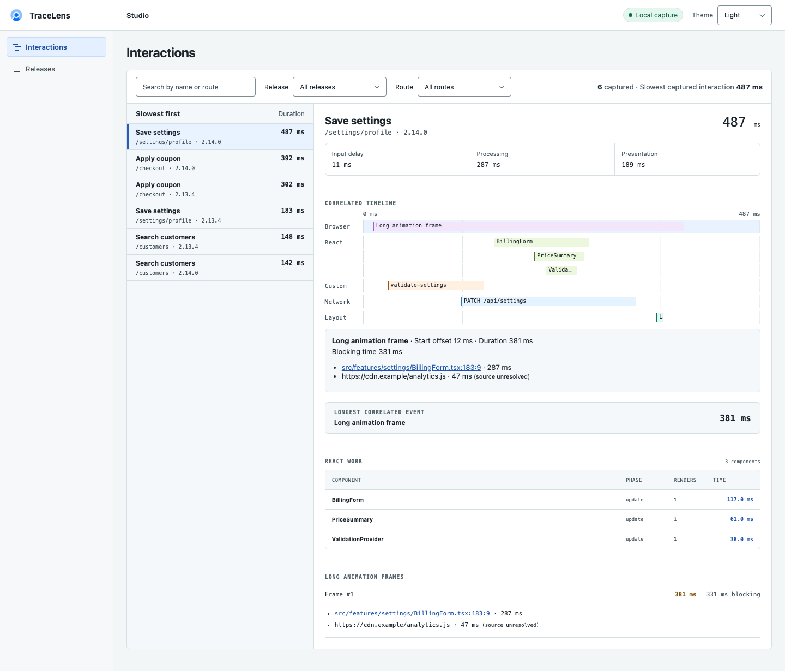
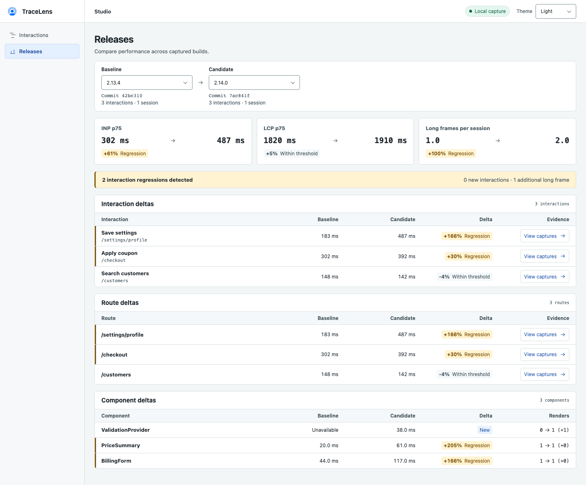

# Debug a slow interaction

This walkthrough uses the TraceLens Playground to move from a slow click to a concrete explanation, then turns that finding into a release budget.

## Start Studio and the playground

```bash
git clone https://github.com/leracherry/tracelens.git
cd tracelens
pnpm install
pnpm build
pnpm dev
```

Open Playground at `http://localhost:4174` and use **Open Studio** to open the local collector at `http://localhost:4173`.

## Reproduce one controlled failure

Choose **Settings save**, set **Load intensity** to `1×`, and click **Save settings**. Open **Interactions** in Studio, search for the action name or route, and narrow the list further with **Release** and **Route** if needed, and choose **Save settings**. The list is sorted by duration.



In the synthetic example below, the interaction takes 487 ms. Use the timing split to decide which evidence to inspect first.

| Subpart      | Question                                               | Typical next move                                            |
| ------------ | ------------------------------------------------------ | ------------------------------------------------------------ |
| Input delay  | What blocked the main thread before the handler began? | Inspect work immediately before processing.                  |
| Processing   | What did the handler execute synchronously?            | Inspect custom spans, React commits, and long-frame scripts. |
| Presentation | What delayed the next painted frame after the handler? | Inspect rendering, style/layout, and follow-up work.         |

In this trace, processing is the largest named segment. That makes synchronous handler work and the overlapping long frame stronger leads than the PATCH request.

## Follow correlated work

Read the timeline from the interaction outward:

1. Select the **Browser** timeline event overlapping the processing interval. Use Enter or Space when it has keyboard focus. The evidence panel shows the start offset and duration.
2. Compare total duration with blocking duration when the browser reports both values.
3. Inspect first-party script contributors. With uploaded source maps, the evidence panel links to the original file when a valid GitHub source link is available.
4. Check React commits during the same interval. A high actual duration or repeated render count points to UI work; absence of a costly commit shifts attention back to application code.
5. Treat the network lane as causal only when its timing supports that claim. A request can share the initiating interaction ID but finish after the INP interval.

Use shared initiation and overlap to form a hypothesis. Confirm causality by changing the suspected work and repeating the capture.

## Confirm the hypothesis

Run **Settings save** again at `0.7×`, `1×`, and `1.4×`. The absolute numbers vary by browser and hardware, but a valid hypothesis should preserve its shape: the suspected custom span or long-frame contributor should grow with the interaction's processing time.

Use the other scenarios to practice distinguishing shapes:

| Scenario          | Simulated problem                        | Evidence to inspect                                               |
| ----------------- | ---------------------------------------- | ----------------------------------------------------------------- |
| Slow search       | Synchronous filtering                    | `filter-search-results` span and overlapping long frame           |
| Settings save     | Serialization and a delayed PATCH        | `serialize-settings` span and `PATCH /api/settings`               |
| Slow checkout     | Delayed POST and render fan-out          | `POST /api/checkout` and `render-order-confirmation` span         |
| Layout thrash     | Repeated geometry reads and style writes | `layout-thrash` span and overlapping long frame                   |
| Third-party block | Simulated analytics bootstrap            | `third-party.analytics.bootstrap` span and overlapping long frame |

Browser long-frame, layout-shift, and source attribution depend on the available performance APIs and the captured work. The local analytics scenario simulates blocking with bundled code. React profiler data requires a profiling-enabled build in production.

## Compare the release

Capture representative baseline and candidate samples with stable `app`, `environment`, route, interaction names, and React boundary names.

Open **Releases**, choose **Baseline** and **Candidate**, and scan the interaction, route, and component deltas. Select **View captures** on an interaction or route row to inspect the matching candidate captures. Use **Back to comparison** to return to the same row and release pair. The comparison reports the observed samples and the Studio threshold.

To compare exported captures from the command line, run this command.

```bash
npx @leracherry/tracelens-cli@1.1.0 compare 2.13.4 2.14.0 \
  --file trace.json
```



## Prevent the regression

Once the population is representative, define a budget for the affected route:

```yaml
minimumSamples: 20

performance:
  inp:
    p75: 200

routes:
  /settings:
    inp:
      p75: 180
```

Check it locally:

```bash
npx @leracherry/tracelens-cli@1.1.0 budget check \
  --config tracelens.yml \
  --file trace.json \
  --release 2.14.0 \
  --app playground \
  --environment production
```

Then move the same check into the [GitHub Action](github-action.md). Insufficient samples fail closed, so missing telemetry cannot silently approve a release.

## What a useful finding looks like

A good TraceLens investigation ends with a falsifiable statement, not merely a red score:

> Save settings regressed in 2.14.0 because `validateSettings` added roughly 280 ms of first-party synchronous work inside the interaction's processing interval. The PATCH completed later and was correlated, but did not account for the INP delay.

That statement tells an engineer what to change, what not to blame, and which budget will catch a recurrence.
